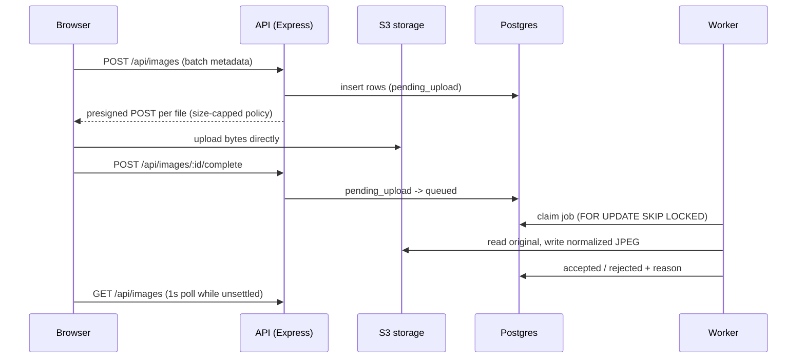

# Photo upload with validation

Upload photos, validate them asynchronously, and sort them into Accepted and Rejected.

## Run

```sh
cp .env.example .env
pnpm install
pnpm infra            # Postgres 16 + SeaweedFS (S3-compatible)
pnpm migrate
pnpm dev              # API :4000, worker, web :5180
pnpm test             # server: rule table + API integration + concurrency
```

Ports: web on 5180, API on 4000, Postgres on 5433, S3 (SeaweedFS) on 9000.
Requires Node 22+, pnpm 10, and Docker.

## API

All endpoints require an `X-Session-Id: <uuid>` header and only ever see that session's images.

| Method | Path | Purpose |
| --- | --- | --- |
| `POST` | `/api/images` | Reserve a batch (`{ files: [{ filename, contentType, size }] }`, max 50) and get a presigned POST per file |
| `POST` | `/api/images/:id/complete` | Mark the upload finished; verifies the object exists, then queues it. Idempotent |
| `GET` | `/api/images` | List the session's images with status, rejection reason, and a signed preview URL |
| `GET` | `/api/images/:id` | Get one image |
| `DELETE` | `/api/images/:id` | Delete the row and its stored objects |

Image status moves `pending_upload` -> `queued` -> `processing` -> `accepted` / `rejected` (with a reason) / `failed` (after 3 attempts).

## Architecture



## Validation pipeline (fail fast, cheapest first)

1. Magic bytes: JPEG, PNG, HEIC only (extension and MIME are never trusted).
2. File size at least 50 KB.
3. HEIC converted with `heic-convert`, then `sharp` applies EXIF rotation and strips metadata.
4. Shortest side at least 512 px.
5. Face detection (`@vladmandic/face-api` on the TF.js WASM backend): no face, multiple faces.
6. Face area under 5% of the image: face too small.
7. Laplacian variance on the face crop: blurry.
8. 64-bit dHash vs the session's accepted images (Hamming distance <= 10), under a per-session advisory lock so concurrent near-duplicates cannot both be accepted.

## Tradeoffs

| Decision | Why | Upgrade path |
| --- | --- | --- |
| Presigned POST, API never touches bytes | API stays small and cheap at any upload volume | - |
| Postgres as the queue | One less moving part; SKIP LOCKED scales to many workers; 3 attempts then `failed` | SQS / BullMQ at very high volume |
| Polling at 1s, only while work is pending | Simple, robust through proxies | SSE or LISTEN/NOTIFY |
| dHash, not face embeddings | Embeddings of the same person always match; we want "same photo", not "same person" | Perceptual hash + embedding of background |
| SeaweedFS locally | MinIO stopped publishing images; RustFS's POST-object upload is broken | Unset `S3_ENDPOINT` to use AWS S3 |
| Anonymous `X-Session-Id` | No auth in scope; every query is still session-scoped | Real auth, same scoping |

## Security

- Content type is decided by magic bytes on the server, not by extension or client MIME.
- Upload size is capped at 25 MB by the presigned POST policy (`content-length-range`) and checked again on the client.
  AWS S3 enforces the policy; enforcement by the local SeaweedFS has not been verified.
- The bucket is private; previews are short-lived signed GET URLs.
- Images are decoded and re-encoded with `sharp`, which strips EXIF (including GPS); only the re-encoded JPEG is ever served back.
- Requests are validated with zod; `helmet`, CORS allowlist, rate limiting, and a 32 KB JSON body limit.

## Test cases

Automated (`pnpm test`), with fixtures derived from source photos by `pnpm --filter server fixtures`:

| Fixture | Expected |
| --- | --- |
| `ok-selfie.jpg` | Accepted |
| `ok-headshot.png` | Accepted |
| `src/selfie.heic` | Accepted (converted from HEIC) |
| `not-an-image.jpg` | Rejected: invalid format (bad magic bytes behind a `.jpg` name) |
| `tiny-bytes.jpg` | Rejected: file too small (< 50 KB) |
| `low-res.jpg` | Rejected: resolution too small (< 512 px) |
| `no-face.jpg` | Rejected: no face |
| `multiple-faces.jpg` | Rejected: multiple faces |
| `face-too-small.jpg` | Rejected: face too small (< 5% of the image) |
| `blurry.jpg` | Rejected: blurry |
| `ok-selfie.jpg` + `similar-selfie.jpg` | One accepted, one rejected as too similar, even when two workers process them at the same time |

The integration test also covers session isolation (another session gets 404), delete, a missing session header (401), and a disallowed content type (400).

Manual QA in the browser:

1. Drop a `.gif` or `.pdf`: rejected instantly on the client, never uploaded.
2. Drop a file over 25 MB: rejected instantly on the client.
3. Drop a mixed batch of the fixtures: blurred previews with upload progress, then each tile moves into Accepted or Rejected.
4. Hover a rejection reason: a tooltip explains how to fix it.
5. Upload the same photo twice: the second is rejected as too similar.
6. Delete an image: it disappears and the accepted counter updates.
7. Reload the page: the gallery is restored from the server for the same session.
8. Stop the worker, upload, then start it: images wait as queued and are processed once it is back.

## What I would do next

- Push status updates over SSE driven by Postgres `LISTEN/NOTIFY` instead of 1 s polling.
- Generate small thumbnails in the worker so the grid does not load full-size JPEGs.
- Run face detection and blur thresholds against a larger labelled set, and tune them from data.
- Add a crop tool for "face too far away" rejections, as in the reference product.
- Real authentication in place of the anonymous session id, with the same per-user scoping.
- Lifecycle rules to remove originals that were reserved but never completed.
- Metrics on queue depth, processing time, and rejection reasons.
