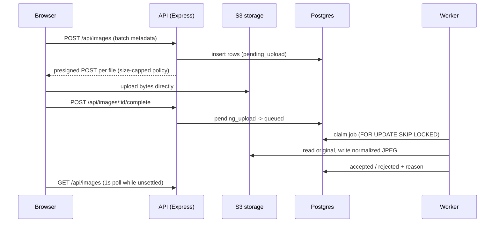

# Photo upload with validation

Upload photos, validate them asynchronously, and sort them into Accepted and Rejected.

## Run

```sh
cp .env.example .env
pnpm install
pnpm infra            # Postgres 16 + SeaweedFS (S3-compatible)
pnpm migrate
pnpm dev              # API :4000, worker, web :5180
pnpm test             # server: rule table + API integration + concurrency
```

## Architecture



## Validation pipeline (fail fast, cheapest first)

1. Magic bytes: JPEG, PNG, HEIC only (extension and MIME are never trusted).
2. File size at least 50 KB.
3. HEIC converted with `heic-convert`, then `sharp` applies EXIF rotation and strips metadata.
4. Shortest side at least 512 px.
5. Face detection (`@vladmandic/face-api` on the TF.js WASM backend): no face, multiple faces.
6. Face area under 5% of the image: face too small.
7. Laplacian variance on the face crop: blurry.
8. 64-bit dHash vs the session's accepted images (Hamming distance <= 10), under a per-session advisory lock so concurrent near-duplicates cannot both be accepted.

## Tradeoffs

| Decision | Why | Upgrade path |
| --- | --- | --- |
| Presigned POST, API never touches bytes | API stays small and cheap at any upload volume | - |
| Postgres as the queue | One less moving part; SKIP LOCKED scales to many workers; 3 attempts then `failed` | SQS / BullMQ at very high volume |
| Polling at 1s, only while work is pending | Simple, robust through proxies | SSE or LISTEN/NOTIFY |
| dHash, not face embeddings | Embeddings of the same person always match; we want "same photo", not "same person" | Perceptual hash + embedding of background |
| SeaweedFS locally | MinIO stopped publishing images; RustFS's POST-object upload is broken | Unset `S3_ENDPOINT` to use AWS S3 |
| Anonymous `X-Session-Id` | No auth in scope; every query is still session-scoped | Real auth, same scoping |
