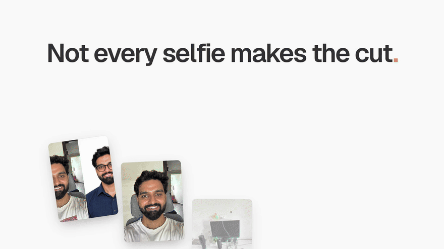
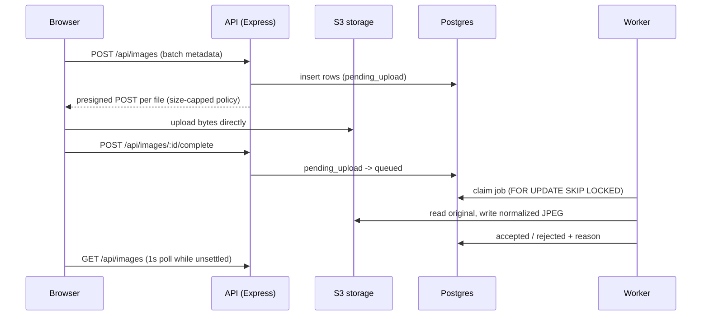

# Photo upload with validation

Upload photos, validate them asynchronously, and sort them into Accepted and Rejected.
Built for the Aragon.ai round 1 challenge ([PROBLEM.md](PROBLEM.md)).

[](brag-output/brag.mp4)

Click the animation to watch the full 20-second demo video with sound.

**Stack:** React + Vite + Tailwind + TanStack Query, Express + Knex, Postgres 16, S3-compatible storage, `sharp` + `heic-convert`, `@vladmandic/face-api` (TF.js WASM).

## Reviewer guide

About 5 minutes from clone to a running app.

### Prerequisites

- Node 22 or newer (`node -v`)
- pnpm 10 (`corepack enable` or `npm i -g pnpm`)
- Docker Desktop, running

The app uses these local ports: web 5180, API 4000, Postgres 5433, S3 9000.
If one is taken, stop whatever is using it (`lsof -i :5180`).

### 1. Install and start

```sh
git clone https://github.com/amantyagi22/aragon-first-round.git
cd aragon-first-round
cp .env.example .env     # local-only credentials for the docker services
pnpm install
pnpm infra               # Postgres 16 + SeaweedFS in Docker, then bucket + CORS + migrations
pnpm dev                 # API on :4000, worker, web on :5180 (Ctrl-C stops all three)
```

Open http://localhost:5180.

### 2. Try it

Sample photos covering every rule are in `server/test/fixtures/`.
Drag them all into the upload box at once:

- `ok-selfie.jpg`, `ok-second-selfie.jpg`, `ok-headshot.png`, `portrait-mode.jpg`, `sideways-exif.jpg`, `src/selfie.heic` go to **Accepted**.
- `near-duplicate.jpg` is a re-encoded crop of `ok-selfie.jpg`, so whichever of the two is processed second is rejected as too similar.
- The rest go to **Rejected**, each labelled with its reason (hover the label for advice).
- `pdf-renamed.jpg` is a PDF named `.jpg`: rejected because its bytes are not an image.
- `animation.gif` is rejected in the browser before uploading.

The full QA script is [docs/QA.md](docs/QA.md); the recording outline is [docs/WALKTHROUGH.md](docs/WALKTHROUGH.md).

### 3. Run the tests

```sh
pnpm test                # needs `pnpm infra` first
pnpm typecheck
pnpm lint                # ESLint + Prettier check
```

`pnpm test` runs 32 tests, all through the public HTTP API with a real worker process: every validation rule, HEIC and EXIF handling, similarity (including a concurrency race), delete, idempotency, session isolation, storage-enforced limits, and real worker crashes (SIGKILL mid-job).

### 4. Where to look

| Path                                  | What it is                                                                |
| ------------------------------------- | ------------------------------------------------------------------------- |
| `server/src/pipeline.ts`              | Validation rules and thresholds (format, size, faces, blur, dHash)        |
| `server/src/worker.ts`                | Postgres-backed queue: claim, process, retry, similarity check under lock |
| `server/src/app.ts`                   | REST API, session scoping, request validation                             |
| `server/src/migrations/001_images.ts` | Schema, enums, constraints, partial indexes                               |
| `server/src/s3.ts`                    | Presigned uploads and signed preview URLs                                 |
| `web/src/App.tsx`                     | Upload UI, previews, progress, accepted/rejected panels                   |
| `web/src/api.ts`                      | API client, direct-to-storage upload, rejection copy                      |
| `server/test/`                        | Rule table, integration, and concurrency tests                            |

### Troubleshooting

- **`Port ... is already in use`**: a previous run is still alive. Run `lsof -i :5180 -i :4000` and stop it.
- **`role "aragon" does not exist`**: `DATABASE_URL` is pointing at another Postgres. It should use port 5433 from `.env.example`.
- **Tests fail to connect**: run `pnpm infra` first, and check `docker compose ps`.
- **Start over with empty data**: `docker compose down -v`, then `pnpm infra`.
- **First face check is slow**: the face model loads on the worker's first job (about a second); later jobs are fast.

## API

All endpoints require an `X-Session-Id: <uuid>` header and only ever see that session's images.

| Method   | Path                       | Purpose                                                                                                    |
| -------- | -------------------------- | ---------------------------------------------------------------------------------------------------------- |
| `POST`   | `/api/images`              | Reserve a batch (`{ files: [{ filename, contentType, size }] }`, max 20) and get a presigned POST per file |
| `POST`   | `/api/images/:id/complete` | Mark the upload finished; verifies the object exists, then queues it. Idempotent                           |
| `GET`    | `/api/images`              | List the session's images with status, rejection reason, and a signed preview URL                          |
| `GET`    | `/api/images/:id`          | Get one image                                                                                              |
| `DELETE` | `/api/images/:id`          | Delete the row and its stored objects                                                                      |

Image status moves `pending_upload` -> `queued` -> `processing` -> `accepted` / `rejected` (with a reason) / `failed` (after 3 attempts).

## Architecture



## Validation pipeline (fail fast, cheapest first)

1. Magic bytes: JPEG, PNG, HEIC only (extension and MIME are never trusted).
2. File size at least 50 KB.
3. Decode (failure is `corrupt`): HEIC converted with `heic-convert`, then `sharp` applies EXIF rotation and strips metadata.
4. Shortest side at least 512 px.
5. Face detection (`@vladmandic/face-api` on the TF.js WASM backend): no face, multiple faces.
6. Face area under 5% of the image: face too small.
7. Laplacian variance on the face crop: blurry.
8. 64-bit dHash vs the session's accepted images (Hamming distance <= 10), under a per-session advisory lock so concurrent near-duplicates cannot both be accepted.

## Tradeoffs

| Decision                                  | Why                                                                                                                                          | Upgrade path                                     |
| ----------------------------------------- | -------------------------------------------------------------------------------------------------------------------------------------------- | ------------------------------------------------ |
| Presigned POST, API never touches bytes   | API stays small and cheap at any upload volume                                                                                               | -                                                |
| Postgres as the queue                     | One less moving part; SKIP LOCKED scales to many workers; 3 attempts then `failed`                                                           | SQS / BullMQ at very high volume                 |
| Polling at 1s, only while work is pending | Simple, robust through proxies                                                                                                               | SSE or LISTEN/NOTIFY                             |
| dHash, not face embeddings                | Embeddings of the same person always match; we want "same photo", not "same person"                                                          | Perceptual hash + embedding of background        |
| SeaweedFS locally                         | MinIO stopped publishing images; RustFS's POST-object upload is broken. Bucket and CORS are set by `pnpm infra` instead of an init container | Unset `S3_ENDPOINT` to use AWS S3                |
| Anonymous `X-Session-Id`                  | No auth in scope; every query is still session-scoped                                                                                        | Real auth, same scoping                          |
| Failed is distinct from rejected          | Failed means the system broke (retry offered), rejected means the photo is bad                                                               | -                                                |
| One reason per image, fail fast           | Cheapest checks first; the detail field keeps the measured value                                                                             | Run all checks if users want every issue at once |
| Blur measured on the face crop            | Portrait-mode backgrounds would otherwise fail                                                                                               | A learned quality model                          |
| Thresholds as code constants              | A rule change is a reviewed diff, not config drift                                                                                           | Per-tenant tuning if ever needed                 |
| Face model loaded once per worker         | Per-image latency stays low                                                                                                                  | GPU workers at volume                            |
| Partial indexes for queue and similarity  | Query cost stays flat as total images grow                                                                                                   | -                                                |
| Uploads capped at 4 concurrent            | Big batches don't saturate the user's connection                                                                                             | Adaptive concurrency                             |
| No crop tool                              | Out of scope for the timebox                                                                                                                 | Crop and re-validate for face-too-small          |
| No pagination                             | Sessions hold tens of images                                                                                                                 | Keyset pagination on (created_at, id)            |
| No abandoned-upload sweeper               | Out of scope; failed browser uploads delete their own row                                                                                    | Periodic sweep plus a storage lifecycle rule     |

## Security

- Content type is decided by magic bytes on the server, not by extension or client MIME.
- Upload size is capped at 120 MB by the presigned POST policy (`content-length-range`) and checked again on the client.
  AWS S3 enforces the policy; enforcement by the local SeaweedFS has not been verified.
- The bucket is private; previews are short-lived signed GET URLs.
- Images are decoded and re-encoded with `sharp`, which strips EXIF (including GPS); only the re-encoded JPEG is ever served back.
- Requests are validated with zod; `helmet`, CORS allowlist, rate limiting, and a 32 KB JSON body limit.

## Test cases

Automated (`pnpm test`), with fixtures derived from source photos by `pnpm --filter server fixtures`:

| Fixture                                                    | Expected                                                        |
| ---------------------------------------------------------- | --------------------------------------------------------------- |
| `ok-selfie.jpg`, `ok-second-selfie.jpg`, `ok-headshot.png` | Accepted                                                        |
| `src/selfie.heic`                                          | Accepted, with a JPEG preview                                   |
| `portrait-mode.jpg`                                        | Accepted (sharp face, blurred background)                       |
| `sideways-exif.jpg`                                        | Accepted, preview upright, no EXIF                              |
| `pdf-renamed.jpg`                                          | Rejected: `unsupported_format`                                  |
| `tiny-thumbnail.jpg`                                       | Rejected: `file_too_small` (< 50 KB)                            |
| `corrupt.jpg`                                              | Rejected: `corrupt` (valid header, garbage body)                |
| `low-resolution.jpg`                                       | Rejected: `low_resolution` (< 512 px)                           |
| `no-face-landscape.jpg`                                    | Rejected: `no_face`                                             |
| `group.jpg`                                                | Rejected: `multiple_faces`                                      |
| `face-too-small.jpg`                                       | Rejected: `face_too_small` (< 5% of the image)                  |
| `blurry.jpg`                                               | Rejected: `blurry`                                              |
| `ok-selfie.jpg` then `near-duplicate.jpg`                  | Second rejected: `too_similar`; accepted in a different session |
| Both completed at the same moment                          | Exactly one accepted                                            |

Also covered: delete frees the slot for a similar photo, double complete is idempotent, other sessions get 404, storage refuses oversized or wrong-type uploads, bad requests get 400/401, and a worker killed mid-job is reclaimed (or the image ends `failed` after 3 crashed attempts).

Manual QA in the browser:

1. Drop a `.gif` or `.pdf`: rejected instantly on the client, never uploaded.
2. Drop a file over 120 MB: rejected instantly on the client.
3. Drop a mixed batch of the fixtures: blurred previews with upload progress, then each tile moves into Accepted or Rejected.
4. Hover a rejection reason: a tooltip explains how to fix it.
5. Upload the same photo twice: the second is rejected as too similar.
6. Delete an image: it disappears and the accepted counter updates.
7. Reload the page: the gallery is restored from the server for the same session.
8. Stop the worker, upload, then start it: images wait as queued and are processed once it is back.

## What I would do next

- Push status updates over SSE driven by Postgres `LISTEN/NOTIFY` instead of 1 s polling.
- Generate small thumbnails in the worker so the grid does not load full-size JPEGs.
- Run face detection and blur thresholds against a larger labelled set, and tune them from data.
- Add a crop tool for "face too far away" rejections, as in the reference product.
- Real authentication in place of the anonymous session id, with the same per-user scoping.
- Lifecycle rules to remove originals that were reserved but never completed.
- Metrics on queue depth, processing time, and rejection reasons.
